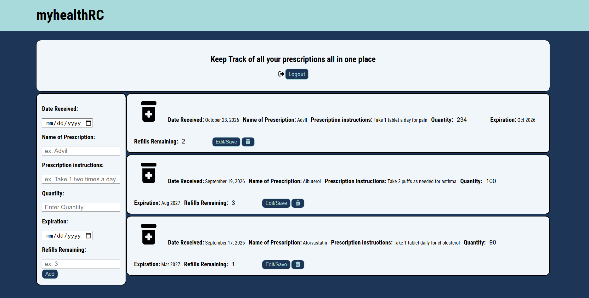

# myhealthRC

A prescription tracker built with Node.js, Express, and MongoDB. Users sign up, log in, and keep all of their prescriptions in one place, including the quantity, when it was received, when it expires, the instructions, and how many refills are left.



## Try it here!
[myhealthRC live site](https://myhealthrc.onrender.com/)

## Features

- User signup and login with authentication
- Add a prescription with the date received, name, instructions, quantity, expiration, and refills remaining
- View all of your prescriptions on one page
- Edit and save changes to a prescription, like updating the refills remaining
- Delete a prescription you no longer need
- Log out when you're done

## Tech Stack

- HTML
- CSS
- JavaScript
- Node.js
- Express.js
- MongoDB

## Project Structure

```
.
├── public/
│   ├── images/
│   ├── styles.css
│   └── main.js
├── views/
├── .env
├── .gitignore
├── package.json
├── server.js
└── README.md
```

## Getting Started

### Prerequisites

- Node.js and npm
- MongoDB instance or MongoDB Atlas connection string

### Installation

```
npm install
```

### Environment Variables

Create a `.env` file in the project root with the following values:

```
DB_STRING=mongodb+srv://<username>:<password>@<cluster>/<database>?retryWrites=true&w=majority
SESSION_SECRET=your-session-secret
```

Replace the placeholders with your own database connection details and a secret of your choosing.

### Run the app

```
node server.js
```

The app runs on port `8080` by default.

## Usage

1. Open the app in your browser.
2. Sign up for an account or log in.
3. Fill out the form on the left with your prescription details and hit Add.
4. Use Edit/Save on a prescription to update it, like when you use up a refill.
5. Use the trash button to delete a prescription.
6. Log out when you're finished.